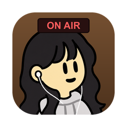
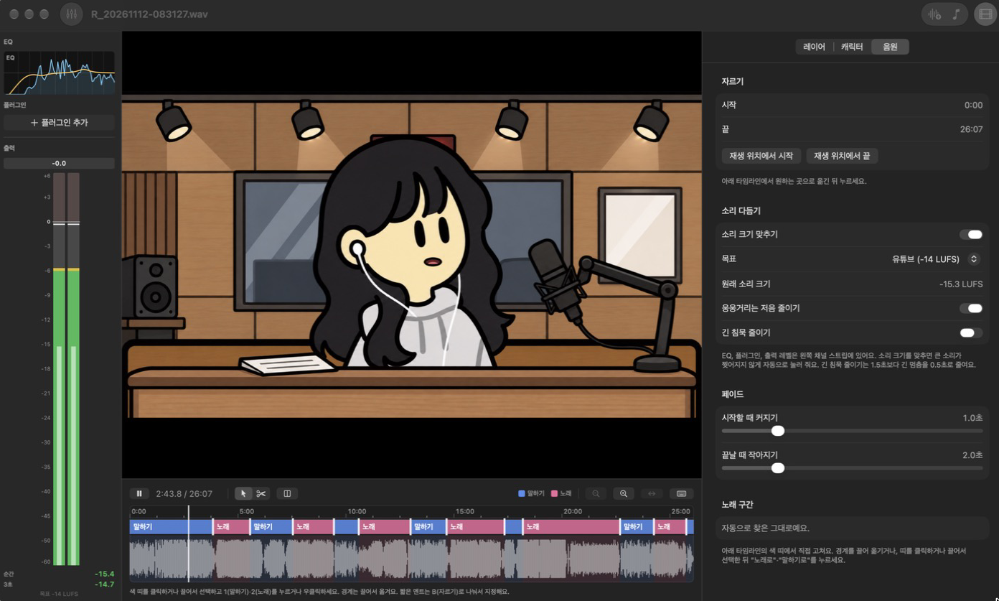
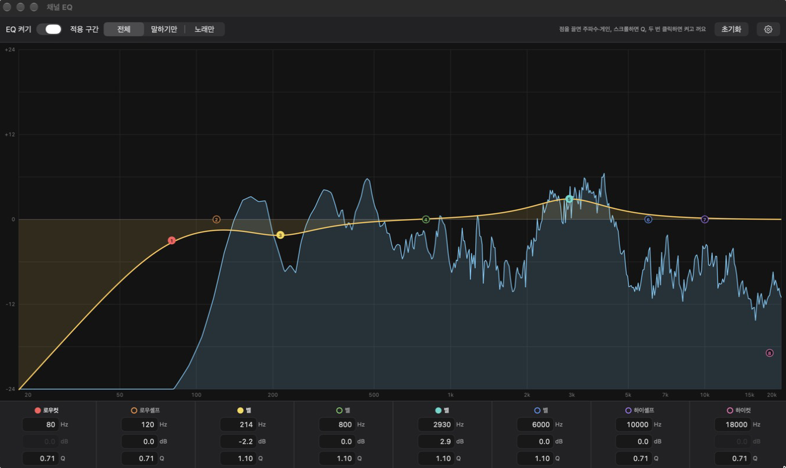

  

<h1 align="center">ABS Radio Maker</h1>

Turn a radio show recording into a video where the host talks, listens, and moves.

  <a href="https://github.com/Lantern111/ABS-Radio-Maker/releases/latest"><strong>Download for Mac</strong></a>
  · macOS 14 or later · Intel and Apple silicon

<a href="#english">English</a> · <a href="#한국어">한국어</a>

## English

ABS Radio Maker is a free Mac app that turns a recording of our evening radio show into a 1920 × 1080 video for YouTube. Drop in the recording, and it finds where songs play and where the host is talking, makes the host's character talk, blink, and listen along, evens out the sound, and exports an MP4. You check the preview and fix only what it got wrong. The app is in Korean.

### Features

- **Finds songs and talk:** Tells songs from talk, including short comments between songs and talking over background music.
- **Knows when the host is speaking:** A small model trained on our own broadcasts checks every quarter of a second whether the host is speaking. The mouth stays shut during pauses, even with music underneath.
- **The character:** The mouth closes, half-opens, or opens wide with the voice. The character sways gently, blinks now and then, and moves along with songs. You choose how often the eyes close while listening, and 24 or 30 frames per second.
- **Layers:** The background, the character, and the desk with its microphone are stacked into one picture. Replace any of them by dragging in a PNG. A square corner cover fits inside the frame on the studio wall.
- **Timeline:** Zoom and scroll through the whole show, cut a stretch in two, and mark it as talk or song. Every change can be undone.
- **Sound:** Trim the start and end, reduce low rumble, shorten long silences, fade in and out, and match YouTube's loudness of −14 LUFS with a peak limiter.
- **Export:** An MP4 video, or just the edited sound as M4A or WAV.

### EQ and Plug-ins

- **8-band EQ:** Low cut, low shelf, four bells, high shelf, and high cut. Drag a point to change its frequency and gain, and scroll over it to change its Q. The curve on screen is exactly what's applied.
- **Spectrum:** Shows the sound as it plays. Choose the style (line, colour bars, or both), smoothing, tilt, FFT size, and frequency scale (Mel, Log, or Linear).
- **Audio Unit plug-ins:** Add the plug-ins installed on your Mac, in any order.
- **Talk only or songs only:** The EQ and each plug-in can work on everything, only while the host talks, or only during songs. Where a stretch changes, the effect fades in or out over a second, so it never switches abruptly.
- **Output meter:** Peak and average levels for left and right, the loudest moment so far, and loudness in LUFS over the last 0.4 and 3 seconds. The scale goes up to +6 dB, so you can see how much headroom is left.

The preview plays all of this live. The video catches up in the background.

### Keyboard Shortcuts

| Key | Action |
|---|---|
| Space | Play or pause |
| J · K · L | Back 5 seconds · Stop · Play (press again for 2×) |
| ← → | Previous or next frame (with ⇧, 10 frames) |
| ↑ ↓ | Previous or next border between stretches |
| A · B | Select tool · Blade tool |
| ⌘B | Cut at the playhead |
| I · O | Start or end of a selection |
| 1 · 2 | Make the selection talk · song |
| ⌘= · ⌘− · ⇧Z | Zoom in · Zoom out · Show all |
| ⌘O | Open a recording |
| ⌘E · ⇧⌘E | Export the video · Export the sound |
| ⌥⌘E | Open the EQ |
| ⌥⌘I | Show or hide the channel strip |

Space and J · K · L also work in the EQ and plug-in windows. The full list is under **Help > Keyboard Shortcuts** (⌥⌘K).

### Installation

1. Go to the [latest release](https://github.com/Lantern111/ABS-Radio-Maker/releases/latest) and download the `.dmg` file under **Assets**.
2. Open the file and drag ABS Radio Maker onto the Applications folder.
3. In the Applications folder, double-click ABS Radio Maker.

ABS Radio Maker isn't signed with a paid Apple developer certificate yet, so macOS shows a warning the first time you open it. To open it anyway:

1. In the warning, click **Done**. Don't click **Move to Trash**.
2. Open **System Settings > Privacy & Security** and scroll down.
3. Click **Open Anyway**.
4. In the window that follows, click **Open**. Enter your Mac's password if asked.

You only need to do this once. The first time you add a plug-in, macOS also asks whether this app may use it. Click **Allow**.

### Updates

Automatic updates are on by default: new versions download in the background and install when you quit the app. You can turn this off in Settings. You can also choose **Check for Updates…** in the ABS Radio Maker menu at any time.

### Reporting a Bug or Suggesting a Change

Choose **Help > 버그 신고…** (Report a Bug) or **Help > 개선 요청…** (Suggest a Change) in the app. The form opens with your app version, macOS version, and kind of Mac already filled in. When something goes wrong, the error window has a **버그 신고…** button that adds the error message too. If the app doesn't open, use [this form](https://docs.google.com/forms/d/e/1FAIpQLSfnS4qldQEQKCwgX6OgdzREBJTIimu18BUjIGCUmZALqMWelw/viewform). You don't need an account.

### Privacy

ABS Radio Maker only reads the recordings you open, and it doesn't change them or send them anywhere. Everything, including finding songs and talk, happens on your Mac. It has no accounts or analytics, and it uses the internet only to check for and download updates. A report is sent only when you submit one yourself.

### Uninstalling

Move ABS Radio Maker from the Applications folder to the Trash. Your recordings and exported videos stay where they are.

## 한국어

ABS Radio Maker는 저녁 라디오 방송 녹음을 유튜브용 1920 × 1080 영상으로 만들어 주는 무료 Mac 앱입니다. 녹음 파일을 넣으면 노래가 나오는 곳과 아나운서가 말하는 곳을 찾습니다. 그에 맞춰 캐릭터가 말하고, 눈을 깜빡이고, 노래를 따라 들으며 움직이게 하고, 소리를 고르게 다듬어 MP4로 내보냅니다. 사람은 미리보기로 확인하고 잘못 잡힌 곳만 고치면 됩니다.

### 주요 기능

- **노래와 말하기 구분:** 노래와 말하는 부분을 나눕니다. 노래 사이의 짧은 멘트와 BGM을 깔고 말하는 부분도 말하기로 잡습니다.
- **말하는 순간 감지:** 우리 방송 녹음으로 직접 학습시킨 작은 모델이 0.25초마다 아나운서가 말하고 있는지 판단합니다. 그래서 BGM이 깔려 있어도 말을 멈추면 입을 다뭅니다.
- **캐릭터:** 목소리에 맞춰 입을 다물고, 조금 벌리고, 크게 벌립니다. 숨 쉬듯 살짝 흔들리고, 가끔 눈을 깜빡이고, 노래가 나오면 따라 움직입니다. 노래를 들을 때 눈을 감는 정도와 화면 속도(24·30 fps)를 고를 수 있습니다.
- **레이어:** 배경, 캐릭터, 책상과 마이크를 겹쳐 한 장면을 만듭니다. PNG를 끌어다 놓아 어떤 그림이든 바꿀 수 있습니다. 정사각형 코너 표지는 스튜디오 벽의 액자 안에 맞춰 들어갑니다.
- **타임라인:** 방송 전체를 확대·축소하며 훑어보고, 구간을 잘라 말하기나 노래로 지정합니다. 모든 수정은 되돌릴 수 있습니다.
- **소리 다듬기:** 앞뒤 자르기, 저음 웅웅거림 줄이기, 긴 침묵 줄이기, 페이드 인·아웃, 피크 리미터와 함께 유튜브 기준(-14 LUFS)으로 소리 크기 맞추기를 합니다.
- **내보내기:** MP4 영상, 또는 다듬은 소리만 M4A나 WAV로 내보냅니다.

### EQ와 플러그인

- **8밴드 EQ:** 로우컷, 로우셸프, 벨 4개, 하이셸프, 하이컷이 있습니다. 점을 끌면 주파수와 게인이, 점 위에서 스크롤하면 Q가 바뀝니다. 화면의 곡선은 실제로 걸리는 소리와 같습니다.
- **스펙트럼:** 재생 중인 소리를 보여 줍니다. 스타일(선, 색 막대, 둘 다), 스무딩, 기울기, FFT 크기, 주파수 눈금(Mel, Log, Linear)을 고를 수 있습니다.
- **Audio Unit 플러그인:** Mac에 설치된 플러그인을 원하는 순서로 겁니다.
- **말하기만, 노래만:** EQ와 플러그인마다 전체, 말하는 구간만, 노래 구간만 중에서 고릅니다. 구간이 바뀌는 곳에서는 1초에 걸쳐 서서히 걸리고 풀려서 갑자기 바뀌지 않습니다.
- **출력 게이지:** 좌우 피크와 평균 레벨, 지금까지 가장 컸던 순간, 0.4초·3초 소리 크기(LUFS)를 보여 줍니다. 눈금이 +6 dB까지 있어서 여유가 얼마나 남았는지 볼 수 있습니다.

미리듣기에는 모두 바로 들리고, 영상에는 뒤에서 이어서 적용됩니다.

### 키보드 단축키

| 키 | 동작 |
|---|---|
| 스페이스바 | 재생 또는 일시정지 |
| J · K · L | 5초 뒤로 · 정지 · 재생(다시 누르면 2배속) |
| ← → | 이전 또는 다음 프레임(⇧와 함께 10프레임) |
| ↑ ↓ | 이전 또는 다음 구간 경계 |
| A · B | 선택 도구 · 자르기 도구 |
| ⌘B | 재생 위치에서 자르기 |
| I · O | 선택 범위 시작 · 끝 |
| 1 · 2 | 선택한 구간을 말하기 · 노래로 |
| ⌘= · ⌘− · ⇧Z | 확대 · 축소 · 전체 보기 |
| ⌘O | 녹음 열기 |
| ⌘E · ⇧⌘E | 영상 내보내기 · 음원 내보내기 |
| ⌥⌘E | EQ 열기 |
| ⌥⌘I | 채널 스트립 보이기 또는 가리기 |

스페이스바와 J · K · L은 EQ 창과 플러그인 창에서도 됩니다. 전체 목록은 **도움말 → 키보드 단축키**(⌥⌘K)에 있습니다.

### 설치 방법

1. [최신 릴리스](https://github.com/Lantern111/ABS-Radio-Maker/releases/latest)의 **Assets**에서 `.dmg` 파일을 내려받습니다.
2. 파일을 열고 ABS Radio Maker를 Applications 폴더로 끌어다 놓습니다.
3. Applications 폴더에서 ABS Radio Maker를 더블클릭합니다.

ABS Radio Maker는 아직 Apple의 유료 개발자 인증을 받지 않아 처음 열 때 경고가 뜹니다. 아래 순서대로 하면 열립니다.

1. 경고 창에서 **완료**를 누릅니다. **휴지통으로 이동**은 누르지 마세요.
2. **시스템 설정 → 개인정보 보호 및 보안**을 열고 아래로 스크롤합니다.
3. **그래도 열기**를 누릅니다.
4. 다시 뜨는 창에서 **열기**를 누릅니다. Mac 암호를 물어보면 입력합니다.

이 과정은 처음 한 번만 하면 됩니다. 플러그인을 처음 넣을 때도 macOS가 이 앱에서 써도 되는지 묻습니다. **허용**을 눌러 주세요.

### 업데이트

자동 업데이트는 기본으로 켜져 있습니다. 새 버전을 내려받아 두었다가 앱을 종료할 때 설치합니다. 설정에서 끌 수 있고, ABS Radio Maker 메뉴의 **업데이트 확인…**으로 직접 확인할 수도 있습니다.

### 버그 신고와 개선 요청

앱에서 **도움말 → 버그 신고…** 또는 **도움말 → 개선 요청…**을 눌러 주세요. 앱 버전, macOS 버전, Mac 종류가 미리 채워진 양식이 열립니다. 오류 창이 뜨면 그 창의 **버그 신고…** 버튼을 눌러도 되고, 이때는 오류 내용도 함께 채워집니다. 앱이 열리지 않는다면 [이 양식](https://docs.google.com/forms/d/e/1FAIpQLSfnS4qldQEQKCwgX6OgdzREBJTIimu18BUjIGCUmZALqMWelw/viewform)을 이용해 주세요. 계정은 필요 없습니다.

### 개인정보

ABS Radio Maker는 여는 녹음 파일을 읽기만 하고, 바꾸거나 어디로 보내지 않습니다. 노래와 말하기를 찾는 일을 포함해 모든 처리는 Mac 안에서 합니다. 계정이나 사용 통계 수집이 없고, 인터넷은 업데이트를 확인하고 받을 때만 사용합니다. 제보는 직접 보내실 때만 전달됩니다.

### 앱 지우기

Applications 폴더에서 ABS Radio Maker를 휴지통으로 옮기면 됩니다. 녹음 파일과 내보낸 영상은 그대로 남습니다.

## Building from Source / 소스에서 빌드하기

Requires Xcode 27.2 or later. Open `ABS Radio Maker.xcodeproj` and run the app. Xcode downloads [Sparkle](https://sparkle-project.org), which delivers updates, on its own.

Xcode 27.2 이상이 필요합니다. `ABS Radio Maker.xcodeproj`를 열고 실행하면 됩니다. 업데이트에 쓰는 [Sparkle](https://sparkle-project.org)은 Xcode가 알아서 내려받습니다.

- `Scripts/make-release.sh` builds the disk image and `appcast.xml` in `dist/`. It needs the update signing key in your Keychain.
- `Scripts/feedback-form.gs` creates the bug report and suggestion form with Google Apps Script.
- `Training` has the tools that train the talk detector. See [Training/README.md](Training/README.md).

## Copyright / 저작권

Copyright © 2026 Lantern111. All rights reserved.

The source code is public so you can read it. Apart from what GitHub's Terms of Service allow, such as viewing and forking it on GitHub, you may not use, copy, modify, or redistribute it without permission. Sparkle keeps its own license.

소스 코드는 읽어 볼 수 있도록 공개되어 있습니다. GitHub 이용 약관이 허용하는 범위(GitHub에서 보기와 포크)를 제외하면, 허락 없이 사용, 복사, 수정, 재배포할 수 없습니다. Sparkle은 자체 라이선스를 유지합니다.
