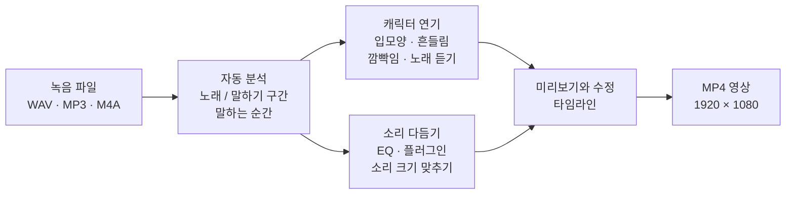

<p align="center">
  
</p>

<h1 align="center">ABS Radio Maker</h1>

<p align="center">
  라디오 방송 녹음을 넣으면, 캐릭터가 말하고 노래를 들으며 움직이는<br>
  유튜브용 영상을 자동으로 만들어 주는 Mac 앱
</p>

<p align="center">
  <a href="https://github.com/Lantern111/ABS-Radio-Maker/releases/latest"><strong>Mac용 내려받기</strong></a>
  · macOS 14 이상 · Intel Mac, Apple 실리콘 Mac 모두
</p>

---

## 이런 앱이에요

방송국 저녁 라디오를 녹음해서 유튜브에 올릴 때, 화면에는 아나운서 캐릭터가 나와요. 말할 때는 입을 움직이고, 노래가 나오면 몸을 흔들며 듣고, 가끔 눈을 깜빡여요. 이걸 편집 프로그램에서 손으로 하면 한 회에 몇 시간씩 걸려요.

ABS Radio Maker는 이 작업을 대신해요. **녹음 파일 하나만 넣으면** 어디가 노래고 어디서 아나운서가 말하는지 스스로 찾아요. 그다음 캐릭터를 그 소리에 맞춰 움직이고, 소리도 유튜브에 맞게 다듬어서 **1920 × 1080 MP4 영상**으로 내보내요. 사람은 미리보기로 확인하고, 틀린 곳만 고치면 돼요.

## 어떻게 동작하나요



1. **분석:** 맥에 들어 있는 소리 분류 기능으로 노래가 나오는 구간을 찾아요. 그 위에 우리 방송으로 직접 학습시킨 **말하기 감지 모델**이 0.25초마다 "아나운서가 지금 말하고 있나"를 판단해요.
2. **캐릭터:** 목소리 크기에 따라 입을 다물고, 조금 벌리고, 크게 벌려요. 말이 멈추면 BGM이 깔려 있어도 입을 다물어요. 노래가 나오면 리듬에 맞춰 흔들며 들어요.
3. **소리:** 웅웅거리는 저음과 긴 침묵을 정리하고, EQ와 플러그인을 거쳐, 유튜브 기준(-14 LUFS)에 맞게 소리 크기를 맞춰요.
4. **확인과 내보내기:** 미리보기에서 들어 보고, 잘못 잡힌 구간은 타임라인에서 고친 뒤 내보내요.

## 주요 기능

### 캐릭터와 화면

- **레이어 합성:** 배경 → 캐릭터 → 책상과 마이크 순서로 겹쳐요. 모든 그림은 끌어다 놓아서 바꿀 수 있어요.
- **입모양과 움직임:** 숨 쉬듯 살짝 흔들리고, 가끔 눈을 깜빡이고, 크게 말하면 조금 더 움직여요. 노래를 들을 때 눈을 감는 정도(눈 뜨고 / 가끔 / 자주 / 계속)와 화면 속도(24·30 fps)를 고를 수 있어요.
- **코너 표지:** 정사각형 코너 표지를 넣으면 배경 벽의 액자 안에 잘리지 않게 들어가요.

### 노래와 말하기 구분

- **자동으로 찾기:** 노래, 노래 사이 짧은 멘트, BGM을 깔고 말하는 부분, 노래 속 랩이나 가사를 구분해요.
- **직접 고치기:** 파이널컷 프로처럼 생긴 타임라인에서 구간을 자르고(B), 말하기(1)나 노래(2)로 바꾸고, 경계를 끌어 옮겨요. ⌘Z로 되돌릴 수 있어요.

### 소리 다듬기

로직 프로의 채널 스트립처럼 창 왼쪽에 모여 있어요. 소리는 **다듬기 → EQ → 플러그인 → 소리 크기 맞추기** 순서로 지나가요. 미리듣기에는 바로 들리고, 영상에는 뒤에서 이어서 적용돼요.

- **채널 EQ:** 로직의 Channel EQ처럼 8밴드(로우컷, 로우셸프, 벨 4개, 하이셸프, 하이컷)예요. 점을 끌어 주파수와 게인을, 스크롤로 Q를 바꿔요. 화면의 곡선은 실제로 걸리는 소리와 같아요.
- **스펙트럼:** MiniMeters처럼 지금 나오는 소리를 보여 줘요. ⚙︎에서 Style(FFT / Color Bars / Both), Smoothing, Tilt, FFT Size, FFT Scale(Mel / Log / Linear)을 바꿔요.
- **플러그인:** 맥에 설치된 Audio Unit 플러그인(Kilohearts, Valhalla, UADx 등)을 순서대로 걸어요.
- **적용 구간:** EQ와 플러그인마다 **전체 / 말하기만 / 노래만**을 골라요. 예를 들어 컴프레서는 목소리에만 걸 수 있어요. 구간이 바뀌는 곳에서는 서서히(기본 1초) 걸리고 풀려서 어색하지 않아요.
- **출력 게이지:** 좌우 피크·평균 레벨, 가장 컸던 순간, 순간·3초 소리 크기(LUFS)를 보여 줘요. 로직처럼 0 위로 +6 dB까지 있어서 여유가 얼마나 남았는지 보여요.
- **음원 편집:** 앞뒤 자르기, 소리 크기 맞추기와 피크 리미터, 저음 웅웅거림 줄이기, 긴 침묵 줄이기, 페이드 인·아웃. 소리만 따로 M4A나 WAV로 내보낼 수도 있어요.

### 편하게 쓰기

- 파이널컷 프로와 같은 키보드 단축키
- 새 버전이 나오면 앱이 알아서 업데이트
- 인텔 맥을 생각해서 화면 갱신과 소리 처리를 가볍게 만들었어요

## 설치하기

1. [최신 릴리스](https://github.com/Lantern111/ABS-Radio-Maker/releases/latest)의 **Assets**에서 `.dmg` 파일을 내려받아요.
2. 파일을 열고 ABS Radio Maker를 **응용 프로그램(Applications)** 폴더로 끌어다 놓아요.
3. 응용 프로그램 폴더에서 더블클릭해서 열어요.

아직 Apple 유료 개발자 인증서로 서명하지 않아서 처음 열 때 경고가 떠요. 처음 한 번만 이렇게 해 주세요.

1. 경고 창에서 **완료**를 누르세요. **휴지통으로 이동**은 누르지 마세요.
2. **시스템 설정 → 개인정보 보호 및 보안**에서 아래로 내려 **그래도 열기**를 누르세요.

처음 쓰는 플러그인은 macOS가 이 앱에서 써도 되는지 물어봐요. **허용**을 눌러 주세요.

## 쓰는 법

1. 녹음 파일(WAV, MP3, M4A, AIFF)을 창이나 Dock 아이콘에 끌어다 놓아요. 녹음 길이에 따라 분석에 1~2분쯤 걸려요.
2. 스페이스바로 들어 보면서 캐릭터가 잘 움직이는지 확인해요. 틀린 구간은 타임라인에서 고쳐요.
3. **영상 내보내기**(⌘E)를 누르면 MP4가 만들어져요. 소리만 필요하면 **음원 내보내기**(⇧⌘E)를 눌러요.

### 노래·말하기 구간 고치기

- **자르기 도구(B)**로 색 띠를 클릭하면 그 자리에서 구간이 둘로 나뉘어요. 노래 사이 짧은 멘트는 앞뒤를 잘라서 지정하면 돼요.
- 구간을 클릭(또는 끌어서 범위를 선택)하고 **1**을 누르면 말하기, **2**를 누르면 노래가 돼요. 우클릭 메뉴로도 바꿀 수 있어요.
- 경계는 끌어서 옮기고, 우클릭으로 지울 수 있어요.

### 소리 다듬기

- 채널 스트립 맨 위의 작은 EQ 화면을 누르면(⌥⌘E) EQ 창이 열려요. 점을 두 번 클릭하면 밴드가 켜지고 꺼져요.
- 플러그인은 **플러그인 추가**로 넣고, 이름을 누르면 플러그인 창이 열려요. 오른쪽 작은 아이콘(파형 / 마이크 / 음표)으로 적용 구간을 골라요.
- EQ·플러그인 창에서도 스페이스바와 J·K·L로 재생할 수 있어서, 들으면서 조절할 수 있어요.

### 키보드 단축키

파이널컷 프로와 같아요. 전체 목록은 **도움말 → 키보드 단축키**(⌥⌘K)에 있어요.

| 키 | 동작 |
|---|---|
| 스페이스바 / J · K · L | 재생·정지 / 5초 뒤로 · 정지 · 재생(다시 누르면 2배속) |
| ← → / ⇧← ⇧→ | 1프레임 / 10프레임 이동 |
| ↑ ↓ | 이전 / 다음 구간 경계로 |
| A / B / ⌘B | 선택 도구 / 자르기 도구 / 재생 위치에서 자르기 |
| I / O / X / ⌥X | 범위 시작 / 끝 / 재생 위치 구간 선택 / 선택 해제 |
| 1 / 2 | 말하기로 / 노래로 |
| ⌘= / ⌘− / ⇧Z | 확대 / 축소 / 전체 보기 |
| ⌘Z / ⇧⌘Z | 실행 취소 / 다시 실행 |
| ⌥⌘I / ⌥⌘E | 채널 스트립 보기·숨기기 / 채널 EQ 창 열기 |

## 그림 준비하기

**레이어** 탭에서 그림마다 **바꾸기…**를 누르거나 끌어다 놓아요. 모든 그림은 배경과 같은 16:9 캔버스에 그리고, 빈 곳은 투명하게 둔 PNG로 저장하세요. 같은 캔버스에서 그린 그림끼리는 자동으로 위치가 맞아요.

| 레이어 | 설명 |
|---|---|
| 배경 | 맨 뒤 그림 |
| 캐릭터 (입 다묾) | 기본 모습 |
| 입 조금 벌림 / 입 크게 벌림 | 말할 때 바뀌는 그림. 캐릭터 그림에서 입만 바꾸면 돼요 |
| 눈 감음 | 깜빡일 때, 노래를 들으며 눈 감을 때 |
| 노래 들을 때 | 선택. 노래 들을 때만 다른 표정을 쓰고 싶을 때 넣어요. 비워 두면 눈 감음 그림을 써요 |
| 책상과 마이크 | 캐릭터 앞에 놓이는 그림 |
| 코너 표지 | 정사각형 표지. 배경의 액자 안에 들어가요 |
| 노래 나올 때 배경 | 선택. 비워 두면 기본 배경을 그대로 써요 |

## 말하기 감지 모델

맥에 들어 있는 소리 분류기는 "BGM이 깔린 채 말하는 것"과 "BGM 속에서 잠깐 쉬는 것"을 잘 구분하지 못해서, 노래만 나와도 캐릭터 입이 움직이곤 했어요. 그래서 우리 방송 녹음으로 작은 모델(260 KB)을 직접 학습시켰어요. 라벨은 손으로 붙이지 않았어요. 마이크는 모노이고 BGM은 스테레오라는 점을 이용해 자동으로 만들었어요.

학습에 쓰지 않은 방송으로 확인했을 때 말함·말 안 함을 99% 넘게 맞혔어요. BGM이 크게(-6 dB) 깔린 쉼에서 입이 움직이는 비율은 12.8%에서 2.1%로 줄었어요. 만드는 방법과 다시 학습시키는 법은 [Training/README.md](Training/README.md)에 있어요.

## 개발

Xcode 27로 `ABS Radio Maker.xcodeproj`를 열어 빌드해요. Swift와 SwiftUI로 만들었고, 소리는 AVFoundation, 그림은 Core Animation, 업데이트는 [Sparkle](https://sparkle-project.org)을 써요.

| 폴더 | 내용 |
|---|---|
| `ABS Radio Maker/App` | 앱 시작, 메뉴, 창 |
| `ABS Radio Maker/Models` | 설정, EQ, 레이어 같은 데이터 |
| `ABS Radio Maker/Services` | 분석, 캐릭터 연기, 소리 처리, 미리듣기, 영상 내보내기 |
| `ABS Radio Maker/Views` | 화면: 미리보기, 타임라인, 채널 스트립, EQ 창 |
| `ABS Radio Maker/Defaults` | 기본 그림 |
| `Training` | 말하기 감지 모델 학습 도구 |
| `Scripts` | 배포 도구 |

### 새 버전 내기

```sh
Scripts/make-release.sh MARKETING_VERSION=1.0.1 CURRENT_PROJECT_VERSION=2
```

`dist/`에 `.dmg`와 `appcast.xml`이 생겨요. 이 둘을 `v<버전>` 태그의 GitHub 릴리스에 올리면, 설치된 앱이 업데이트를 받아요.

```sh
git tag -a v1.0.1 -m "ABS Radio Maker 1.0.1" && git push origin v1.0.1
gh release create v1.0.1 dist/ABSRadioMaker-1.0.1.dmg dist/appcast.xml --title "ABS Radio Maker 1.0.1"
```

업데이트 서명 키는 키체인에 있어요(Sampl Moa와 같은 키). `CURRENT_PROJECT_VERSION`은 배포할 때마다 1씩 올려야 앱이 새 버전으로 알아봐요.
